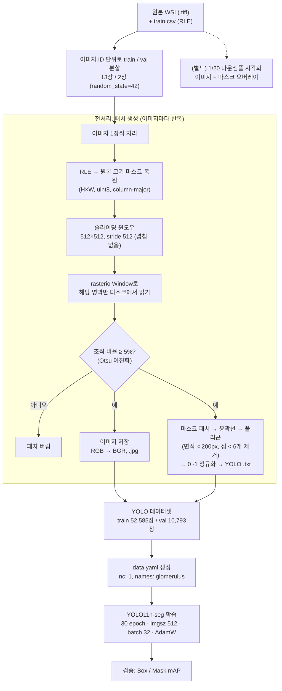
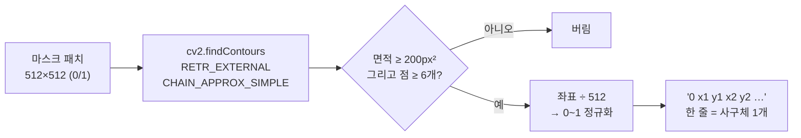

# 신장 사구체(Glomerulus) 분할 — YOLOv11-seg

거대한 신장 조직 병리 이미지(WSI, TIFF)에서 **사구체(glomerulus)**를 찾아 픽셀 단위로 분할하는 프로젝트입니다.
수만 × 수만 픽셀짜리 원본 이미지를 **512×512 패치로 자르고**, 사구체 마스크(RLE)를 **YOLO 폴리곤 라벨**로 바꾼 뒤 **YOLOv11n-seg**로 인스턴스 분할을 학습합니다.

| 항목 | 내용 |
|---|---|
| 데이터 | HuBMAP — Hacking the Kidney (Kaggle), 학습용 TIFF 15장 + `train.csv`(RLE 마스크) |
| 작업 | 사구체 인스턴스 분할 (클래스 1개: `glomerulus`) |
| 모델 | Ultralytics **YOLO11n-seg** (사전학습 가중치에서 파인튜닝, 약 2.8M 파라미터) |
| 입력 | 512×512 패치 (원본 해상도 그대로, 다운샘플링 없음) |
| 결과 (검증) | **Mask mAP50 0.907 · Mask mAP50-95 0.692** / Box mAP50 0.912 · Box mAP50-95 0.721 |
| 환경 | NVIDIA RTX 4060 Ti (8GB), PyTorch 2.9.1 + CUDA 12.8, Ultralytics 8.3.241, 30 epoch에 약 2.95시간 |

---

## 1. 전체 워크플로우



노트북 `yolov11 - kidney.ipynb`의 셀 순서도 위 흐름과 같습니다.

| 셀 | 하는 일 |
|---|---|
| 0 | 라이브러리 import, 하이퍼파라미터(`PATCH_SIZE`, `STRIDE`, `MIN_TISSUE` 등), 출력 폴더 생성 |
| 1, 5 | GPU / CUDA 확인 |
| 2 | 함수 정의: `rle2mask`, `tissue_ratio`, `mask_to_polygons` |
| 3 | **패치 생성 메인 루프**: 분할 → 마스크 복원 → 슬라이딩 윈도우 → 조직 필터 → 이미지·라벨 저장 |
| 4 | `data.yaml` 작성 |
| 6 | YOLO11n-seg 학습 |
| 7 | 검증 (`model.val()`) |
| 8–9 | 1/20 다운샘플 이미지 + 마스크 오버레이 시각화 |

---

## 2. 데이터

- **출처**: Kaggle **HuBMAP — Hacking the Kidney** 대회 데이터
- `train/*.tiff`: PAS 염색 신장 조직 WSI, 장당 수만 × 수만 픽셀
- `train.csv`: `id`(이미지 ID), `encoding`(사구체 마스크의 **RLE 문자열**)
- 학습에 쓴 이미지: **15장** → 이미지 ID 기준으로 **train 13장 / val 2장** (`train_test_split(test_size=0.1, random_state=42)`)

> **이미지 단위로 나눈 이유**: 같은 슬라이드에서 나온 패치가 train과 val에 함께 들어가면 비슷한 조직이 양쪽에 섞여 검증 점수가 부풀려집니다. 그래서 패치를 만들기 **전에** 슬라이드 단위로 먼저 나눴습니다.

---

## 3. 이미지 전처리 상세

### 3-1. 이미지 피라미드 / 멀티스케일 사용 여부

**학습용 전처리에는 이미지 피라미드(멀티 해상도)를 쓰지 않습니다.**

| 단계 | 해상도 | 방식 |
|---|---|---|
| 학습 패치 생성 (셀 3) | **원본 해상도 1:1** | `rasterio`의 `Window`로 512×512 영역만 바로 읽음. 축소·확대 없음 |
| 시각화 (셀 8) | **1/20 다운샘플** | `src.read(out_shape=…, resampling=bilinear)`로 처음부터 작은 크기로 읽음 |

- 패치 하나가 원본의 512×512 픽셀과 정확히 일치하고, 모델 입력 크기(`imgsz=512`)와도 같아서 **추가 리사이즈 없이** 그대로 학습에 들어갑니다.
- 1/20 다운샘플은 슬라이드 전체 모습과 마스크 위치를 **눈으로 확인하는 용도**로만 쓰고, 학습 데이터에는 쓰지 않습니다.

### 3-2. 메모리를 아끼는 읽기 방식 (rasterio Window)

WSI 한 장을 통째로 메모리에 올리면 수 GB가 필요합니다. 그래서 이미지를 한 번에 읽지 않고,

```python
with rasterio.open(img_path) as src:
    window = Window(x, y, 512, 512)      # 읽을 영역만 지정
    patch = src.read(window=window)      # (C, H, W) — 해당 영역만 디스크에서 읽기
    patch = np.moveaxis(patch, 0, -1)    # (H, W, C)
```

처럼 **필요한 패치 영역만** 디스크에서 읽습니다. 이미지 하나를 다 처리하면 `del full_mask; gc.collect()`로 마스크 메모리를 바로 해제합니다.

> 다만 마스크는 `rle2mask`로 **원본 크기(H×W) 전체를 한 번에** 복원합니다. uint8 기준으로 이미지 한 장당 수백 MB~1GB 이상의 메모리를 씁니다.

### 3-3. RLE → 마스크 복원 (`rle2mask`)

```
"start₁ length₁ start₂ length₂ ..."   (1부터 시작, 세로 방향 순서)
```

1. 문자열을 나눠 짝수 위치는 `starts`, 홀수 위치는 `lengths`로 분리
2. `starts -= 1` (RLE는 1부터, numpy는 0부터 시작)
3. 길이 `H × W`인 1차원 배열에서 `[start, start + length)` 구간을 1로 채움
4. `reshape((H, W), order='F')` — RLE가 **열 우선(column-major)** 순서이므로 Fortran 순서로 2차원 복원
5. RLE가 없으면(NaN) 전부 0인 마스크 반환

### 3-4. 패치 자르기 (슬라이딩 윈도우)

| 설정 | 값 | 의미 |
|---|---|---|
| `PATCH_SIZE` | 512 | 패치 한 변의 길이 (px) |
| `STRIDE` | 512 | 이동 간격 = 패치 크기 → **겹침 없는(non-overlapping) 격자** |

```python
for y in range(0, h - PATCH_SIZE, STRIDE):
    for x in range(0, w - PATCH_SIZE, STRIDE):
        ...
```

```
x →  0      512     1024    1536 ...      (w − 512 미만까지)
y  ┌───────┬───────┬───────┬──
↓  │ p(0,0)│p(512,0)│      │
   ├───────┼───────┼───────┼──
   │       │       │       │
   ├───────┼───────┼───────┼──
   │  ...  │       │       │     ← 오른쪽·아래 끝의 512 미만 자투리는 버려짐
```

- 패치 파일 이름: `{이미지ID}_{x}_{y}.jpg` / `.txt` → 원본에서의 **좌상단 좌표**를 그대로 기록
- `range(0, h − 512, 512)`라서 **오른쪽·아래 가장자리**(512px 미만 자투리, 경우에 따라 마지막 한 줄 전체)는 패치로 만들어지지 않습니다.

### 3-5. 빈 패치 거르기 — 조직 비율 (`tissue_ratio`)

WSI의 상당 부분은 조직이 없는 흰 배경입니다. 이런 패치를 줄이려고 **Otsu 이진화**로 조직 비율을 계산합니다.

1. RGB → 그레이스케일
2. `cv2.threshold(..., THRESH_BINARY + THRESH_OTSU)` — 패치마다 밝기 분포를 보고 자동으로 임계값을 정해 흑/백으로 나눔
3. **어두운 쪽(0) 픽셀 = 조직**으로 보고 그 비율을 계산 (H&E/PAS 염색에서 조직은 배경보다 어두움)
4. 비율이 `MIN_TISSUE = 0.05`(5%) 미만이면 **버림**

### 3-6. 이미지 저장

- `rasterio`는 RGB 순서로 읽고 OpenCV는 BGR로 저장하므로 `cv2.cvtColor(RGB2BGR)`로 바꾼 뒤 `.jpg`로 저장합니다.
- 흑백(1채널) 패치는 `GRAY2BGR`로 3채널로 맞춥니다.
- 색상 정규화나 염색 정규화(stain normalization)는 하지 않습니다.

### 3-7. 마스크 → YOLO 폴리곤 라벨 (`mask_to_polygons`)



- `RETR_EXTERNAL`: 가장 바깥 윤곽선만 사용 (구멍은 무시)
- `CHAIN_APPROX_SIMPLE`: 직선 구간의 점을 줄여 폴리곤을 가볍게 만듦
- **노이즈 제거**: 면적이 200px² 미만이거나 점이 6개 미만(선분 형태)인 윤곽은 버림
- 라벨 형식 (YOLO segmentation): `클래스 x1 y1 x2 y2 ...` (클래스는 항상 `0` = glomerulus)
- 사구체가 없는 패치도 **빈 `.txt`**를 만들어 **배경 이미지**로 학습에 넣습니다 (False Positive 억제).

### 3-8. 결과 데이터셋

```
WORK_DIR/
├── data.yaml                 # path, train/val 경로, nc: 1, names: ['glomerulus']
├── train/
│   ├── images/{id}_{x}_{y}.jpg
│   └── labels/{id}_{x}_{y}.txt
└── val/
    ├── images/...
    └── labels/...
```

| 분할 | 슬라이드 | 패치 수 | 배경 패치 (사구체 없음) | 사구체 포함 패치 |
|---|---|---|---|---|
| train | 13 | 52,585 | 46,254 (88%) | 6,331 |
| val | 2 | 10,793 | 9,411 (87%) | 1,382 (인스턴스 1,707개) |

---

## 4. 모델 학습

### 4-1. 모델

- **YOLO11n-seg** (Ultralytics) — YOLOv11 nano 크기의 인스턴스 분할 모델
  - 박스 검출 헤드 + 마스크 프로토타입 헤드로 객체마다 마스크를 예측
  - 203 layers, 약 2.84M 파라미터, 9.7 GFLOPs
- COCO 사전학습 가중치 `yolo11n-seg.pt`에서 시작 (561개 중 510개 텐서 전이, 클래스 수가 다른 헤드 일부만 새로 초기화)

### 4-2. 학습 설정

| 파라미터 | 값 | 비고 |
|---|---|---|
| `epochs` | 30 | 30 epoch 모두 수행 (조기 종료 없음) |
| `imgsz` | 512 | 패치 크기와 같음 |
| `batch` | 32 | |
| `optimizer` | AdamW | `lr0 = 1e-3`, momentum 0.937, weight decay 0.0005 |
| `patience` | 5 | 5 epoch 동안 개선이 없으면 조기 종료 (실제로는 발동 안 함) |
| AMP | 사용 | 혼합 정밀도 학습 |
| 데이터 증강 | Ultralytics 기본값 | Mosaic, HSV 색 변화, 좌우 반전, 스케일·이동 등. 마지막 10 epoch는 Mosaic 끔 (`close_mosaic`) |
| `workers` / `device` | 4 / GPU 0 | |

> `augment=True`는 Ultralytics에서 **추론 시 TTA 옵션**이라 학습 증강과는 상관이 없습니다. 검증 단계에서 "Model does not support 'augment=True'" 경고가 나오고 무시됩니다. 학습 증강은 위의 기본값으로 적용됩니다.

### 4-3. 결과 (val 슬라이드 2장, 패치 10,793장)

| 구분 | Precision | Recall | mAP50 | mAP50-95 |
|---|---|---|---|---|
| **Box** | 0.911 | 0.849 | 0.912 | 0.721 |
| **Mask** | 0.909 | 0.847 | **0.907** | **0.692** |

- 추론 속도: 패치당 약 1.1~1.7ms (RTX 4060 Ti)
- 학습 결과물은 `hubmap_project/run_v1/`에 저장됩니다 (`weights/best.pt`, 학습 곡선, 라벨 분포 등).

---

## 5. 시각화 — 1/20 다운샘플 오버레이 (셀 8)

슬라이드 전체와 마스크 위치를 한눈에 보기 위한 보조 코드입니다.

1. **이미지**: `rasterio`의 `out_shape=(C, H//20, W//20)`, `Resampling.bilinear`로 **처음부터 작게** 읽어서 원본 전체를 메모리에 올리지 않습니다. 이후 `to_uint8`로 8bit 변환, 채널 수를 3으로 맞춤.
2. **마스크**: `rle_to_downsample_mask`가 원본 크기 마스크를 **만들지 않고** RLE를 바로 1/20 크기 격자에 찍습니다.
   - RLE의 시작/끝 인덱스를 `divmod(idx, H)`로 (열, 행)으로 바꾸고, 해당 열 구간을 `// 20`으로 줄여 작은 마스크에 표시
   - 메모리 사용이 원본의 약 1/400
3. 왼쪽에 원본(축소), 오른쪽에 마스크를 `alpha=0.5`로 겹쳐서 표시 (예시: `0486052bb`)

---

## 6. 실행 방법

### 환경

```bash
pip install ultralytics rasterio opencv-python shapely pandas numpy scikit-learn tqdm matplotlib
```

- CUDA GPU 필요 (셀 5에서 GPU가 없으면 `assert`로 멈춤)

### 순서

1. Kaggle에서 HuBMAP — Hacking the Kidney 데이터를 내려받습니다.
2. 셀 0의 경로를 채웁니다. 기본값이 빈 문자열이라 **꼭 설정해야 합니다.**
   ```python
   DATA_ROOT = "path/to/hubmap-kidney-segmentation"   # train/, train.csv 가 있는 폴더
   WORK_DIR  = "path/to/work"                          # 패치·라벨이 저장될 폴더
   ```
3. 셀 0 → 7을 순서대로 실행합니다 (전처리 → `data.yaml` → 학습 → 검증).
4. (선택) 셀 8–9로 다운샘플 시각화

> 패치 6만여 장이 `.jpg`로 저장되므로 디스크 공간이 넉넉해야 합니다. 셀 7 끝의 `shutil.rmtree(WORK_DIR)` 주석을 풀면 학습 후 패치를 지웁니다.

---

## 7. 한계 및 개선 방향

| 항목 | 현재 | 개선 방향 |
|---|---|---|
| **패치 경계** | 겹침 없는 격자라 경계에 걸친 사구체가 두 패치로 **잘림** | stride를 줄여 겹치게 자르기 (예: stride 256) |
| **가장자리** | 오른쪽·아래 512px 미만 자투리를 버림 | 패딩 후 마지막 위치까지 자르기 |
| **멀티스케일** | 원본 해상도 한 가지만 사용 | 다운샘플 피라미드로 조직 영역을 먼저 찾고, 원본 해상도에서 자르기 / 다중 배율 학습 |
| **조직 필터** | Otsu는 패치마다 임계값을 따로 잡아서, 거의 빈 패치도 통과할 수 있음 | 슬라이드 전체 기준 임계값, 채도(HSV-S) 기준 필터 |
| **클래스 불균형** | 패치의 약 88%가 배경 | 배경 패치 다운샘플링, 사구체 주변 위주로 샘플링 |
| **마스크 메모리** | 원본 크기 마스크를 통째로 복원 | 패치 영역만 RLE에서 복원 |
| **저장 형식** | `.jpg` (손실 압축) | `.png` 또는 품질 지정 |
| **검증** | 슬라이드 2장으로 1회 분할 | 슬라이드 단위 K-Fold |
| **추론** | 테스트 슬라이드 추론, 패치 합치기, RLE 제출 코드가 없음 | 겹침 슬라이딩 추론 → 이어붙이기 → RLE 인코딩 |
